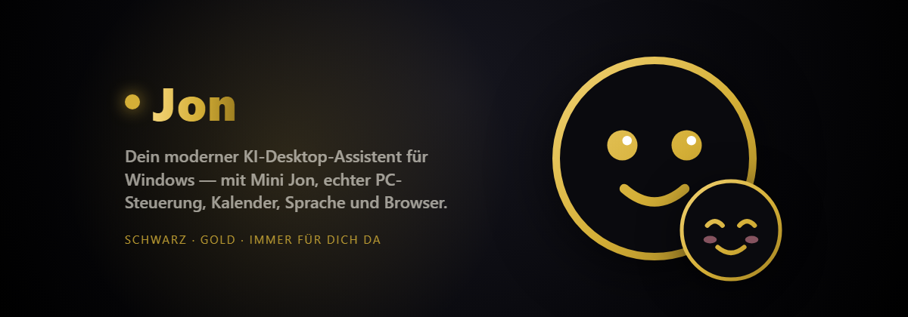
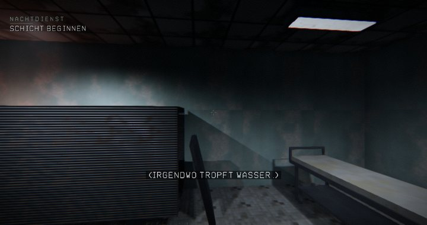
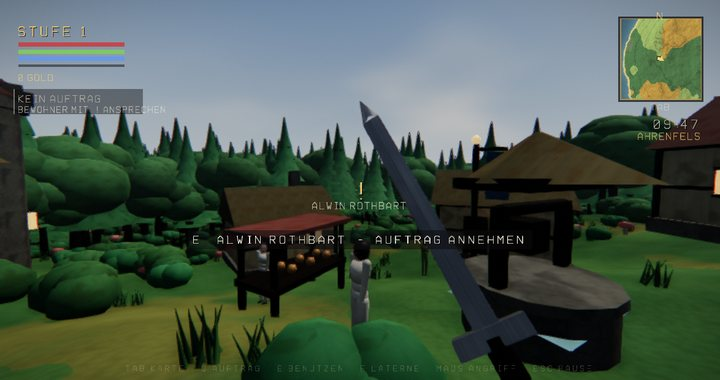
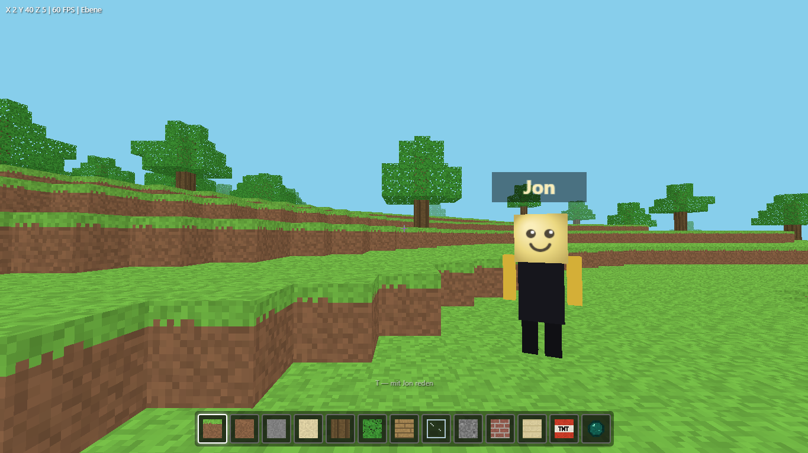
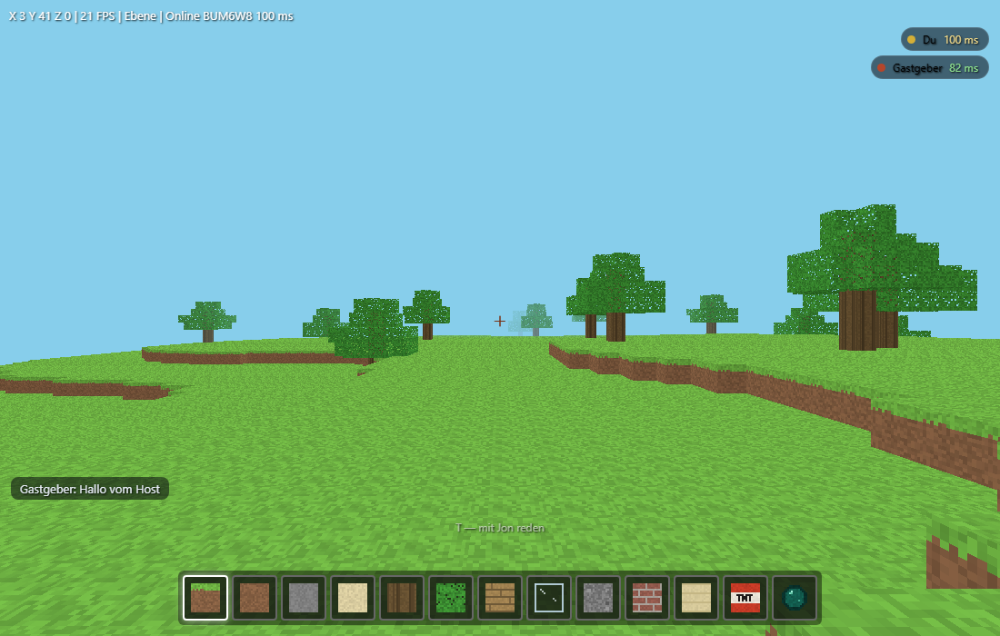

<div align="center">



# Jon — AI Desktop Assistant

**An assistant that doesn't just talk — it actually operates your PC.**

**New in 4.65.8:** Telegram answers right away: Jon confirms a shutdown in 0.2 s, simple questions come back in under a second, and "click Start" on a web page works in 2 s. Presentations get checked, fitting photos, text no longer runs off the slide, and images added later no longer cover text. The terminal harness `jonh` is fully tested with FelWorks without a key and without Premium.

[](CHANGELOG.md)
[](https://getjon.info)
[](LICENSE)
[](https://getjon.info)

[](https://github.com/Lightning702/Jon---AI/releases/latest/download/Jon-Setup.exe)
[](https://github.com/Lightning702/Jon---AI/releases/latest/download/Jon-Windows.zip)
[](https://getjon.info)

[Deutsche Version](README.md) · [Changelog](CHANGELOG.md) · [Setup](#setup)

</div>

---

Jon is a modern AI desktop assistant for Windows with multi-provider support,
streaming, long-term persistence, real system control, mouse/keyboard automation,
voice control, an editable skill system and a standalone phone app. Backend in
Python/FastAPI, frontend in Electron + React + TypeScript in a black/gold glassmorphism
design.

<div align="center">

### Installing Jon in two minutes

[](https://www.youtube.com/watch?v=tjVsXAmi750)

*The video is in German — the steps are the same. Click the image to watch.*

</div>

---

## Three games. Two players. One friend code.

The **FelWorks Game Collection** ships inside Jon — and since v3.34 you play all of it
together over a six-character code. Since v3.36.3 that code is all you need on a home
network: Jon looks for the host on the LAN and connects your laptop to your PC by itself.

<table>
<tr>
<td width="50%" align="center">

<br><b>ECHO</b><br><sub>Psychological horror · 4 floors · 464 rooms · five endings</sub>
</td>
<td width="50%" align="center">

<br><b>AETHERIA</b><br><sub>Fantasy open world · villages, quests, world map</sub>
</td>
</tr>
<tr>
<td width="50%" align="center">

<br><b>Blockwelt</b><br><sub>Voxel sandbox where Jon builds for you</sub>
</td>
<td width="50%" align="center">

<br><b>Online co-op</b><br><sub>Shared world, ping display, team chat</sub>
</td>
</tr>
</table>

---

## What's new in Jon 4.59 to 4.65

Everything added since version 4.58, in short. The full list is in the
[changelog](CHANGELOG.md) (German).

### Jon Harness in the terminal: `jonh`

- **One-line install.** In PowerShell `irm https://getjon.info/install.ps1 | iex` or straight
  from GitHub
  `irm https://raw.githubusercontent.com/Lightning702/Jon---AI/main/website/install.ps1 | iex`,
  on macOS and Linux `curl -fsSL https://getjon.info/install.sh | sh`. Then `jonh` starts in
  any folder, while `jon` stays the regular Jon.
- **A coding and work agent like Claude Code or Codex:** read, write and edit files, run
  commands, search the web, task list, diffs, undo and a project memory in `JON.md`.
- **Connects to Jon by itself** and uses its model and all Jon tools (PowerPoint, Word,
  images, screen). Without Jon it works standalone.
- **FelWorks without a key.** `/api` asks for the provider first (NVIDIA, OpenAI, Anthropic,
  Gemini, DeepSeek, OpenRouter, Groq, Mistral, xAI, Ollama, LM Studio), then once for the key,
  which is stored encrypted.
- **Updates itself.** `/update` (or `jonh update`) downloads the new version from the GitHub
  release, verifies its SHA-256 checksum and swaps the file. `/update auto` installs new
  versions on start.

### `/goal`, visible thinking and `/btw`

- **`/goal <goal>`** works in the app chat, on Telegram, in the phone app, on the watch, in
  `jon` and in `jonh`. Jon works in rounds with all tools and strictly checks after each round
  whether the goal is really reached, for up to twelve rounds.
- **Visible thinking everywhere**, live with a timer. The "Blitzschnell" setting turns it off.
- **`/btw` asks on the side** without interrupting Jon. `/btw danach: …` queues a follow-up
  task that Jon runs when he is done.

### Telegram

- Fast first answers, live-updating messages and approval buttons.
- Control the PC: `/aus`, `/neustart`, `/schlafen`, `/sperren`, `/bildschirm`, `/video`,
  `/live`, `/modell`, `/anbieter` or plain sentences like "shut down the PC in 10 minutes".
- **Send things to your phone:** "send me the presentation on my phone" or the "Aufs Handy"
  button on every file card. Only from allowed folders and only to your own chat.
- Reminders at a given time and a morning message with your timetable and the weather.

### Jon understands your screen

"Click Start", "click Sign in in the Chrome window": Jon reads windows, buttons and fields
through Windows UI Automation and OCR, brings the right window to the front and clicks or
types there, also via Telegram. Security prompts, firewall dialogs and UAC are never clicked
by Jon.

### Research, presentations and documents

- **Web search that finds things:** Bing, Wikipedia, Hacker News and more, with a second try
  using the key words. The browser only opens when you ask for it.
- **Presentations that look hand-made:** a new light default design, real free-to-use photos
  with sources, charts and tables. Existing PowerPoint and Word files are edited in place.
- **Live workshop:** slides, Word pages, Excel cells, code and terminal commands appear live.

### Blender: houses, cities, rooms, clocks and space

Jon builds Blender scenes from ready-made building blocks with real sizes, proper materials
and a fitting camera: houses with recessed windows, doors, porch roof, tiled roof, gutters and
chimney; trees, forests, ground and a sky for day, morning, evening, night or clouds; whole
cities with crosswalks, high-rises whose windows light up at night, trees, street lights and
cars; furnished rooms with sofa, armchair, table, chairs, bed, wardrobe, bookshelf, kitchen,
TV, rug, plants, lamps and pictures; wall clocks and alarm clocks; cars and a photo studio;
black holes, planets, suns and galaxies. Jon checks the camera at the end, rewrites
truncated scripts shorter and translates old Blender 3 names automatically.

### Code, test environment and harness in the app

- Code blocks in the chat with preview, run, save and copy. Websites and games run inline.
- **Jon Testumgebung (`/test`):** a disposable sandbox with files, editor, terminal and preview,
  a real Linux machine when Docker is running.
- **Harness in the app:** drag and drop images, videos and other files into the input, paste
  them with `Ctrl+V` or pick them with the paper clip.

### More

- **Jon Lehrer:** a full course with lessons, exercises, spaced repetition and a mock test from
  your own material.
- **Models per task, local servers and offline mode.**
- **One Jon for all devices:** phones, tablets, PCs and Wear OS watches, "Where is …?",
  PCs on the home network find each other.
- **Light and Cozy themes** for every window, a microphone for dictation, the team centre for
  admins and developers.

---

## Download Jon

| | Ready-made | From source |
| --- | --- | --- |
| For whom | just use it | contribute, Pi, Linux |
| Prerequisites | none | Python 3.12+, Node.js 20+ |
| Time | ~2 minutes | ~10 minutes |

**Ready-made** — from [getjon.info](https://getjon.info) or the
[GitHub releases](https://github.com/Lightning702/Jon---AI/releases/latest):

- **Jon-Setup.exe** — installer with start menu and desktop shortcut
- **Jon-Windows.zip** — portable: unzip, run `Jon.exe`

Both contain the Jon app, Mini Jon, the full backend (starts automatically) and the
games. No Python, no Node.js, no `.env` — you enter API keys inside the app under
**Accounts**. See [installing with the .exe](#installing-with-jon-setupexe) below.

**From source** — clone the repository and follow the [setup guide](#setup):

```bash
git clone https://github.com/Lightning702/Jon---AI.git
```

**Requirements:** Windows 10/11, [Python](https://www.python.org/downloads/) 3.12+ and
[Node.js](https://nodejs.org/) 20+.

**No installation:** The phone app runs directly in the browser at
[https://getjon.info/app](https://getjon.info/app/).

---

## Features

- **Mini Jon** — Jon's little son lives as a cute glowing circle on your desktop:
  always on top, movable, there from Windows startup. He greets you with updates, listens
  continuously (say "Jon" once, then just keep talking), speaks with lip-sync, and can do
  everything the big Jon can. Face, colours, eyes and size are fully customizable.
- **Voice control** — Offline wake-word detection ("Jon") via openWakeWord in the
  backend, with automatic fallback to in-window recognition. Barge-in: talk while Jon is
  speaking and he stops instantly. Sensitivity is adjustable in the gear menu.
- **Real system control** — PowerShell/CMD, launch/kill programs, read/write/move/delete
  files, mouse and keyboard automation, screenshots, window management.
- **Trash & action log** — Deletes, overwrites and moves are backed up to `data/trash`
  first (kept 30 days). `/undo` restores the last file action, `/trash` lists everything.
  Every tool call is logged with source (app, Mini Jon, Telegram, automation, watcher);
  `/log` shows the recent actions with filters.
- **Browser automation** — Jon drives a visible Chromium window (Playwright):
  `browser_goto/click/fill/read/screenshot/back/close`. He reads a page before clicking and
  never logs in or buys anything without explicit confirmation.
- **Calendar** — A local calendar (month/week view) in the black/gold design. Jon adds,
  moves and searches appointments by voice ("Add dentist Friday 3pm"), warns about
  conflicts, and shows automations, reminders and your connected ICS calendar side by side.
  `/calendar` shows the next 7 days.
- **Auto-update** — `/update` pulls the latest version, backs up `data/` first, reinstalls
  only what changed, and restarts (on the Raspberry Pi via `systemctl restart jon`).
- **Games built in** — The FelWorks Game Collection ships with Jon: **ECHO**
  (first-person psychological horror) and **AETHERIA** (fantasy open-world RPG) run as
  their own window, the **Blockwelt** voxel sandbox opens in a browser tab. Find them under
  Tools → Games; nothing launches on its own, only the **Start** button opens a game and Jon
  stays open. Drop a folder with a `jon-spiele.json` next to Jon to add your own.
- **Ollama built in** — Run every answer on your own hardware: free, private, no API key.
  The gear menu has its own **Ollama** area with server status (online/offline, response
  time, Ollama version, selected model, number of installed models, last successful
  connection), a connection test, model management and every knob that matters —
  temperature, top P, top K, max tokens, context length, keep alive, seed, system prompt,
  streaming, timeout and automatic reconnect. The server may live on this PC, on another
  machine on your LAN or on a Tailscale host; Jon talks to it through the official Ollama
  API. Full guide: [docs/OLLAMA.md](docs/OLLAMA.md).
- **Share your Ollama server** — Hand out a share code or invite link and other Jon
  users can chat through your GPU: private, invite-only or public. Their client picks the
  server up automatically in the model selector, streaming and all Ollama settings
  included. You see every connected user with status, model, sessions and last activity,
  and can revoke access instantly. Every request carries a personal token (stored hashed);
  only model inference is shared — never your chats, files or PC control.
- **English & German** — Switch the whole UI and Jon's replies between German and English
  in the gear menu.
- Plus: knowledge base, automations, reminders, friends chat, Telegram bot (with photo
  analysis and direct mouse/keyboard control), evening show, password vault, flashcards,
  and more.

---

## Setup

### Installing with `Jon-Setup.exe`

**1. Download**

[Jon-Setup.exe](https://github.com/Lightning702/Jon---AI/releases/latest/download/Jon-Setup.exe)
(~280 MB). Prefer not to install anything?
[Jon-Windows.zip](https://github.com/Lightning702/Jon---AI/releases/latest/download/Jon-Windows.zip)
is portable — unzip, run `Jon.exe`, skip steps 2 and 3.

**2. Dismiss the Windows warning**

SmartScreen shows *"Windows protected your PC"* on first run. That is not a virus — the
file simply isn't signed with a paid certificate. Click **More info** → **Run anyway**.
The full source is in this repository, so you can always build Jon yourself.

**3. Install**

The installer asks for a target folder, creates start menu and desktop shortcuts and
launches Jon afterwards. It installs **per user**, so no administrator rights are needed.
Included: the Jon app, Mini Jon, the complete backend and the FelWorks Game Collection.

**4. Add an API key**

Without a key Jon cannot think. In the app: **person icon (top right) → Accounts** →
pick a provider → paste the key → save. Jon then lists every available model by itself.

A free start: [build.nvidia.com](https://build.nvidia.com) → create an account →
generate an API key (starts with `nvapi-`). Keys are stored locally in `accounts.json`
only — never in the repository, never in a cloud.

> **Tip:** Jon and Mini Jon use separate models. With **one** key they share it. Enter
> **two keys separated by a comma** and the first belongs to Mini Jon and Telegram, the
> second to Jon — then they never slow each other down.

**Or skip the key entirely:** install [Ollama](https://ollama.com/download), run
`ollama pull llama3.2`, then switch it on in **gear menu → Ollama**. Jon answers locally,
for free, without any account.

**5. Get going**

- `Ctrl+Alt+J` — show/hide the Jon window
- `Ctrl+Alt+Space` — quick question anywhere on screen
- `Ctrl+Alt+K` — Mini Jon on/off
- **Tools → Games** or `/spiele` — ECHO, AETHERIA, Blockwelt

**Where is my data?** Everything lives in `%LOCALAPPDATA%\Jon\data` — chats, memory,
accounts, knowledge base, save games. Updates never touch that folder.

**Quitting.** The **X** shuts Jon down completely, backend included. To keep him running
in the background (hotkeys stay active), use the **⌄** button next to it or the tray
entry *Im Hintergrund weiterlaufen*.

**Updating.** `/update` in the chat: Jon downloads the new version himself, verifies it,
asks once, closes and installs. He restarts on his own afterwards; your data stays.

**Uninstalling.** Windows Settings → *Apps* → **Jon** → Uninstall. The data folder stays
on purpose — delete `%LOCALAPPDATA%\Jon` by hand to remove everything.

---

### From source

#### 1. Environment variables

```bash
cp .env.example .env
```

Put your API keys in `.env`. **Keys never belong in source code.** Alternatively connect
providers at runtime in the accounts area.

```
NVIDIA_API_KEY=nvapi-...
DEFAULT_PROVIDER=nvidia
DEFAULT_JON_MODEL=nvidia/nemotron-3-ultra-550b-a55b
DEFAULT_EMIL_MODEL=meta/muse-glimmer-30b
```

#### 2. Backend

```bash
cd backend
python -m pip install -r requirements.txt
python -m app.main
```

Backend: `http://127.0.0.1:8756` — API docs: `http://127.0.0.1:8756/docs`.

#### 3. Frontend

```bash
cd frontend
npm install
npm run dev
```

`npm run dev` starts Vite and Electron together. `npm run build` creates a production
build, `npm run package` a Windows installer (electron-builder).

Details and troubleshooting: [docs/DEVELOPMENT.md](docs/DEVELOPMENT.md).

### Always on: Jon on a Raspberry Pi

To reach Jon around the clock from phone and smartwatch — even when the PC is off — the
backend can run on a Raspberry Pi (Pi 4 or newer):

1. `git clone https://github.com/Lightning702/Jon---AI.git jon`
2. `cd jon && bash pi-installieren.sh`
3. Enter API keys: `nano .env`, then `sudo systemctl restart jon`

The script installs everything, builds the web app and sets up a systemd service that
starts automatically on boot. Reach Jon at `http://<Pi-IP>:8756/app`.

---

## Security

- API keys live only in your local `.env` or the local account store, never in the code.
- All system control respects the approval mode ("ask first" / "allow all").
- `JON_LAN=1` exposes Jon to your local network — only enable it in a trusted network.
- The trash keeps deleted files for 30 days so mistakes are recoverable.
